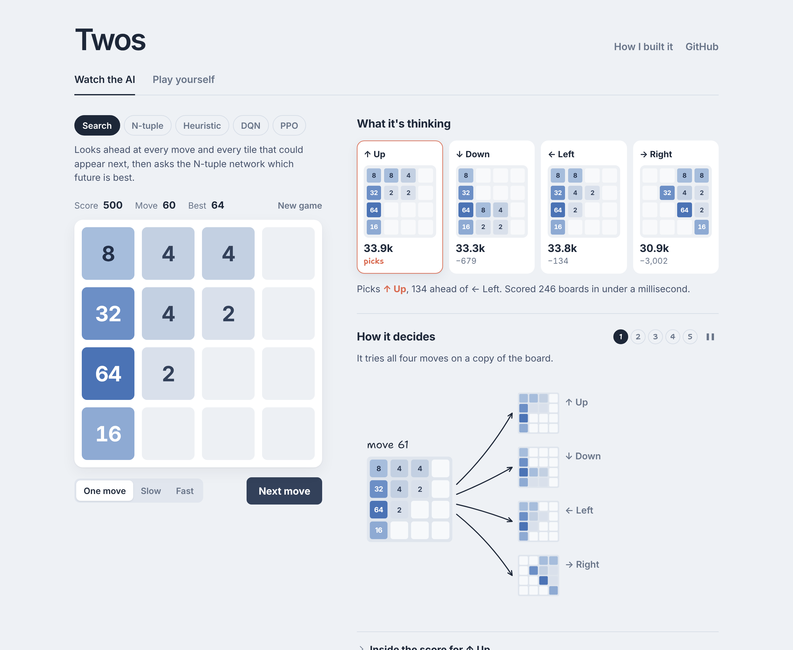

# Twos

Watch five models play the sliding-tile game 2048 and see what each one is
thinking, move by move. Or play it yourself.

**[Play it here](https://charliehubbard7.github.io/2048-rl-sandbox/)**



Five models are included, from a hand-written heuristic to reinforcement learning
with search on top. All of them run client-side: the models were trained in Python,
exported to small weight files, and re-implemented in plain JavaScript, with no
build step and no runtime dependencies.

## How it works

The page opens on **Watch the AI**:

- **One move / Slow / Fast.** Step through a game a move at a time (Space works
  too), or let it play. Before every move the model's reasoning appears first, then
  the move happens.
- **What it's thinking** shows the four boards each move would produce, what the
  model scored each one, and a one-line verdict.
- **How it decides** is a hand-drawn storyboard of the algorithm, drawn with the
  real board and the real numbers from the current move.
- **Inside the numbers**, folded away until opened, breaks one score down: the
  heuristic's four weighted rules, the N-tuple network's 32 table lookups, the
  search's map of where the next tile could land, or the networks' attention and
  hidden activations.

**Play yourself** is the classic game: slide, merge equal tiles once per move, a 2
(90%) or 4 (10%) appears in a random empty cell, and reaching 2048 lets you keep
going. The search will give you a hint if you ask.

## The models

| Model | Idea |
|---|---|
| Search + N-tuple | Expectimax over the tiles that could spawn next (two plies when the board is crowded), scoring leaves with the N-tuple network |
| N-tuple network | Four 6-cell patterns shared across all 8 board symmetries, trained with TD(0) on afterstates |
| Deep Q-network | Double DQN on one-hot boards with experience replay and a Polyak-averaged target network |
| PPO | Actor-critic with invalid-move masking and GAE |
| Heuristic | Greedy one-move lookahead over empty cells, merge pairs and a snake-shaped corner gradient |

### How strong they are

Thirty seeded games per model, played by the same JavaScript the site runs
(`npm run benchmark -- 30`):

| Model | Mean score | Median | Reached 2048 | Reached 4096 | Best tile |
|---|---:|---:|---:|---:|---:|
| Search + N-tuple | 109,744 | 122,368 | 97% | 97% | 8192 |
| N-tuple network | 55,334 | 65,720 | 90% | 53% | 4096 |
| Heuristic | 10,007 | 7,624 | 7% | 0% | 2048 |
| Deep Q-network | 7,687 | 7,424 | 3% | 0% | 2048 |
| PPO | 7,351 | 7,620 | 0% | 0% | 1024 |

Training budgets on a laptop CPU: N-tuple 60 minutes (55,000 self-play games),
DQN and PPO 30 minutes each.

The gap between the N-tuple models and the neural networks is the interesting
part. An N-tuple network is linear over a huge sparse feature space, so each update
touches only the 32 weights that describe the board in front of it. The neural
networks have to discover that structure from scratch.

## Repository

```
site/              the public page: vanilla ES modules, served as-is
  js/engine.js     rules on exponent boards, with a 65,536-entry line lookup table
  js/game.js       a game with tile identities, so moves can be animated
  js/ai/           the five models, run in a web worker
  js/watch/        the thinking panel and the hand-drawn explainer
  models/          exported weights (gzipped, int16-quantised)
rl2048/            Python: engine, agents, training and export
scripts/           benchmark for the browser models
tests/             pytest for Python, node:test for the JavaScript
```

The JavaScript is pinned to the Python implementation by parity tests. The
exporter writes fixtures computed from the exact weights the browser receives, and
`npm test` checks that every move, board value, search result and network output
matches.

## Running it

```bash
npm run serve                     # http://127.0.0.1:8765
npm test                          # javascript tests
npm run benchmark -- 50           # play 50 seeded games with each browser model
```

Training and exporting need Python 3.11+:

```bash
python3.12 -m venv .venv
.venv/bin/pip install -r requirements.txt
.venv/bin/pytest

.venv/bin/python -m rl2048.train ntuple --minutes 60   # also: dqn, ppo
.venv/bin/python -m rl2048.export models               # writes site/models + fixtures
```

## Notes

- **Engine:** boards store tile exponents. Every move is a flip or transpose plus a
  lookup into a table of precomputed line slides. Python batches this with NumPy, so
  the N-tuple network trains on tens of thousands of games an hour.
- **Weights:** exports quantise floats to int16 with one scale per array. For the
  N-tuple tables, only weights larger than 50 points are shipped (a sweep showed no
  measurable loss in strength, and it cuts the file from 10 MB to 1.6 MB), as
  sorted keys stored as gaps, which the browser looks up by binary search.
- **Explanations:** the N-tuple heatmap spreads each active weight over the tiles
  its pattern covers. The neural networks use occlusion: how much the output moves
  when each tile is removed.

## License

MIT
